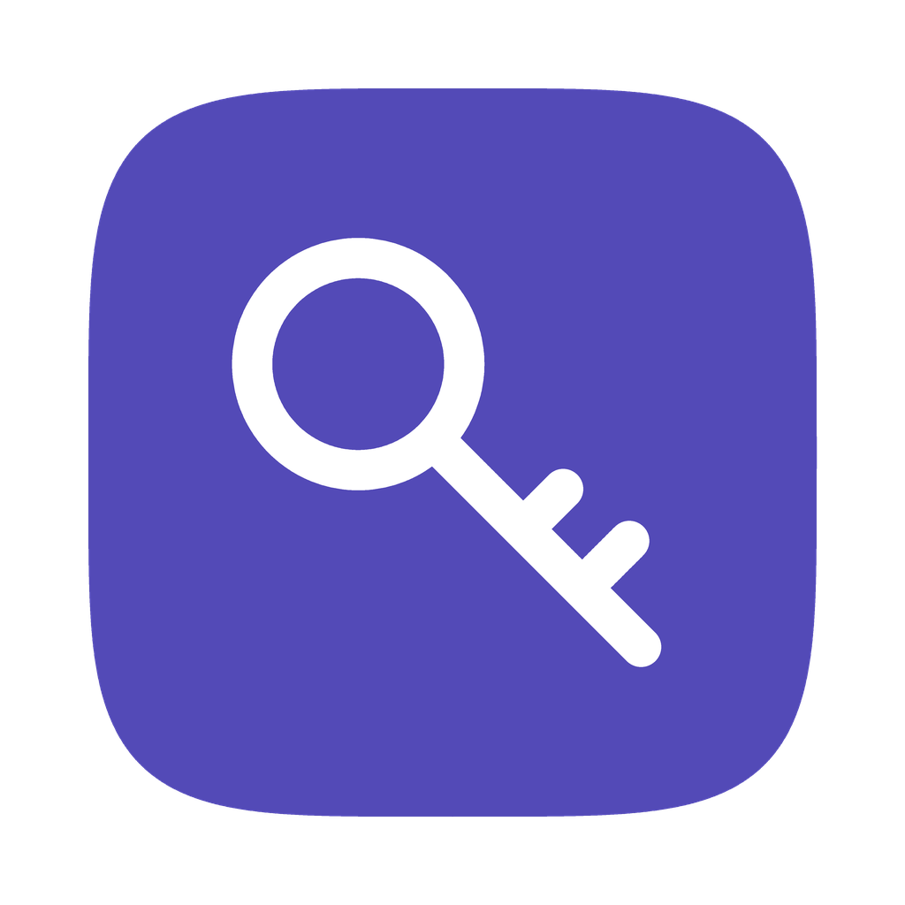

# AMS Shortcut Overview

A small Mac menu bar app that puts the keyboard shortcuts you are learning on your desktop: one colour card per app, along the bottom of the screen, behind your windows. Tick a shortcut when you know it and it disappears; two weeks later it comes back once to check you still know it.

- Starts with 8 shortcuts each for Obsidian, Raycast and Autodesk Fusion.
- Add your own from the menu bar or the + on a card; any app gets its own colour.
- Day and night colours. Nothing leaves your Mac.

Build: `Tools/install.sh` (needs XcodeGen). Rules and tests: `Core` (`swift test`). Details: [Docs/SPEC.md](Docs/SPEC.md).
